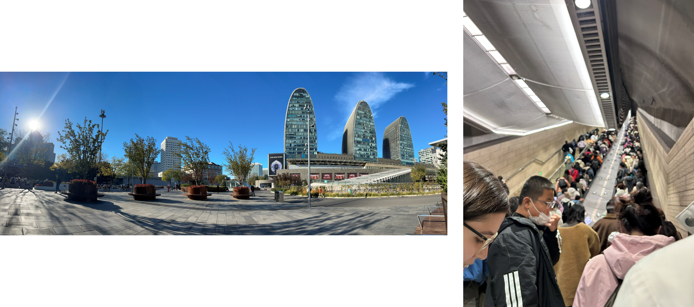
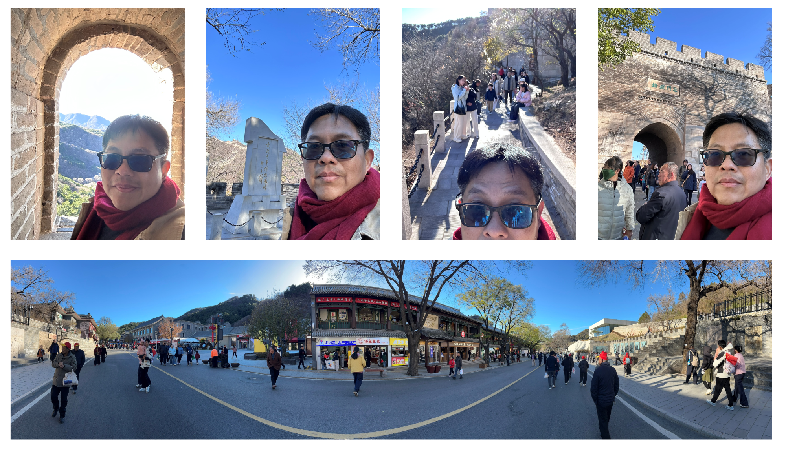

เมื่อต้นตุลาที่ผ่านมา มีคนติดต่อมาให้ไปร่วมงาน APEC forum ที่ปักกิ่ง จีน ในหัวข้อ “Innovating for Health: A Multi-disciplinary Forum on AI in Healthcare” งานจัด 7-8 พย ที่ผ่านมา เขาขอให้ไปถึงวันที่ 6 เพราะวันที่ 7 เริ่มตั้งแต่ 8 โมงเช้า วันที่ 9 ผมมีสอบเด็กที่นัดไว้แล้ว เลยตกลงว่าไปถึงเช้าวันที่ 6 ละกัน จะได้มีเวลาเที่ยวเล็กน้อย 

ก่อนไปก็ลองดูว่าจะไปดูอะไรดีที่ปักกิ่ง หลัก ๆ ก็มี กำแพงเมืองจีน พระราชวังต้องห้าม และพระราชวังฤดูร้อน แต่พระราชวังต้องห้ามกับพระราชวังฤดูร้อนดูแล้วต้องลงทะเบียนล่วงหน้า ซึ่งผมมารู้เกือบเดินทางแล้ว เลยเลือกกำแพงเมืองจีนแทน พอลองหาข้อมูลเพิ่มปรากฏว่ามีจุดชมกำแพงเมืองจีนหลายจุดอยู่ แต่จุดที่ดูแล้วเดินทางสะดวกสุดคือ Badaling (ป่าต้าหลิง) ที่มีรถไฟความเร็วสูงเดินทางไปถึง 

ก่อนเดินทางเลยแจ้งทีมจัดงานว่าจะไปเที่ยวกำแพงเมืองจีนก่อนนะ เขาเลยบอกให้รีบจองตั๋วรถไฟความเร็วสูงนะ เพราะคนเยอะมาก พอลองเช็คดูก็พบว่าเราสามารถจองตั๋วได้ง่าย ๆ ผ่าน trip.com ซึ่งพอลองดูแล้วตั๋วมันก็เกือบเต็มจริง ๆ สำหรับคนที่ไม่เคยใช้ ต้องเตือนว่าบางครั้งมันบอกว่ายังมีที่นั่งอยู่แต่ถ้าเรากรอกช้าอาจกลายเป็นว่าเราไปอยู่ใน waiting list แทน โชคดีที่วันที่ผมไปถึงยังมีตั๋วทั้งไปและกลับ โดยขาไปคือ Beijingbei → Badaling และขากลับคือ Badaling → Qinghe  คือหาที่กลับมาที่เดิมไม่ได้ Qinghe จริง ๆ ก็เป็นสถานีความเร็วสูงถัดไปจาก Beijingbei ขากลับต้องต่อ subway ปกติจาก Qinghe เลยรู้สึกได้ว่าความเร้วต่างกันเยอะจริง

การซื้อตั๋วผ่าน trip.com ต้องใช้ passport ด้วย ซึ่งพอไปถึงจีนจริง ๆ เลยพบว่า data เขามัน connect กันจริง ๆ คือตอนเดินเข้าสถานีก็ยื่น passport ให้เขา เขากรอกหมายเลขเพื่อตรวจตั๋ว ตอนจะขึ้นรถไฟเขามีการตรวจตั๋ว 100% เลย สำหรับคนจีนก็จะเอา ID card ไปแปะที่เครื่อง ส่วนนักท่องเที่ยวก็เอา passport ไปแปะแทน แต่ต้องเป็นเครื่องเฉพาะที่มักจะอยู่ไม่ขวาสุดก็ซ้ายสุด 

ของที่น่าสนใจอีกอันคือการตรวจกระเป๋า ที่ปักกิ่งมีเครื่องสแกนกระเป๋าเยอะมากทั้งสนามบินและสถานีรถไฟ และที่จุดสแกนมักมีป้ายห้าม drone อยู่ไม่รู้ทำไมเหมือนกัน ที่สถานีรถไฟความเร็วสูงมีตรวจน้ำดื่มด้วยคือถ้าถือไปเขาจะให้ดื่มให้ดู แค่นิดเดียวก็พอไม่ต้องหมดขวด

ขาไปถึง 05:30 รับกระเป๋าไม่นาน แต่ผ่าน ตม. นานอยู่ คือต้องมีการสแกนลายนิ้วมือเข้าระบบเขาด้วย ซึ่งที่ด่าน ตม. สังเกตว่าเขาจะเปิดเสียงบอกว่าให้ทำอะไรเป็นภาษาของเจ้าของ passport จริง ๆ ก่อนไป ตม. ต้องมีการกรอกเอกสารเข้าประเทศก่อน ซึ่งผมกรอกตั้งแต่ตอนอยู่สนามบินแล้ว ตอนแรกกะว่าจะกรอกว่ามี invite มาจากจีน แต่ไม่มีเบอร์ของคนที่ติดต่อได้ เลยกรอกแค่ว่าไป conference โดยไม่มี invitation แทน ซึ่งกรอกเสร็จก็จะได้ QR code มา แต่ไม่เห็นมีใครตรวจเลย

ออกจาก ตม ได้ก็เกือบ 7 โมงมั๊ง ดีที่ตั๋วไป Badaling มัน 10:30 เลยชิล ๆ แต่ผมขี้ไม่อยากลากกระเป๋าไปเที่ยวด้วย เลยเอาฝากไว้ที่สนามบินก่อน เพราะโรงแรมอยู่ใกล้ ๆ 

ไปถึง Beijingbei มีเวลาเลยออกไปเดินเล่นหากาแฟกิน หนาวมาก ดีที่เอาผ้าพันคอมาด้วย ตอนขึ้นรถไฟไม่ได้รู้สึกว่าคนเยอะเท่าไร แต่ตอนเดินขึ้นนี่ถึงเห็นว่าคนเยอะมากๆๆๆ 

พอถึง Badaling ความมั่วเริ่มเกิดขึ้น เริ่มจากผมไปซื้อตั๋ว cable car กะว่าจะนั่งขึ้นไปและเดินลง ปรากฏว่าพอจะไปขึ้นเจ้าหน้าที่บอกว่าปิดซ่อม และให้ไป ground cable car ที่เป็นรางแทน ผมก็เดินตามทางที่เขาบอกแต่ไม่เจอสักที พอถาม Deepseek มันบอกให้ไปขึ้น shuttle ก็ขึ้นไปแล้วก็ลงตามคนอื่นแต่พอลงมาก็ยังไม่เจอ ground cable car ก็ไปต่อคิว shuttle ใหม่อีกรอบ รอบนี้เจอคิวขึ้น ground cable car แต่คิวยาวมากๆๆๆๆ พอไปถึงทางเข้าก็ตรวจบัตร 100% เหมือนเดิม กว่าจะขึ้นไปก็บ่ายกว่า สรุปใช้เวลากว่า 2 ชั่วโมงกว่าจะขึ้นไป พอขึ้นไปนึกว่าจะมีร้านนั่งกินชิล ๆ กลายเป็นเจอแค่บูธเล็ก ๆ เลยได้ไส้กรอกมากินระหว่างเดินขึ้น

เดินขึ้นไปพักนึงก็เจอทางลงที่เดินเลียบกำแพงลงมา ซึ่งเดินง่ายกว่าหน่อยเพราะทางเรียบกับคนน้อย แต่มันดันไม่มีแผนที่ชัด ๆ ว่าลงไปแล้วจะไปโผล่ที่ไหน แล้วจะต้องต่อ shuttle หรือเปล่า เลยเดินลงมาเร็วหน่อยเผื่อเวลาไว้ก่อน พอลงมาข้างล่างถึงเห็นว่ามีร้านอาหารเยอะอยู่แล้วก็อยู่ใกล้กับสถานีรถไฟฟ้าความเร็วสูงด้วย จริง ๆ ถ้ารู้ก่อนรู้งี้มาเดินขึ้นทางนี้ก็ดี 555

ขากลับไปลง Qinghe แล้วต่อ subway กลับไปสนามบินไปรับกระเป๋า จริง ๆ แล้วถ้ารีบก็ไปกินมื้อเย็นที่งาน APEC ได้ แต่อยากไปชิล ๆ เลยแวะกินบะหมี่ที่สนามบินแทนแล้วค่อยไปโรงแรม จบวัน

