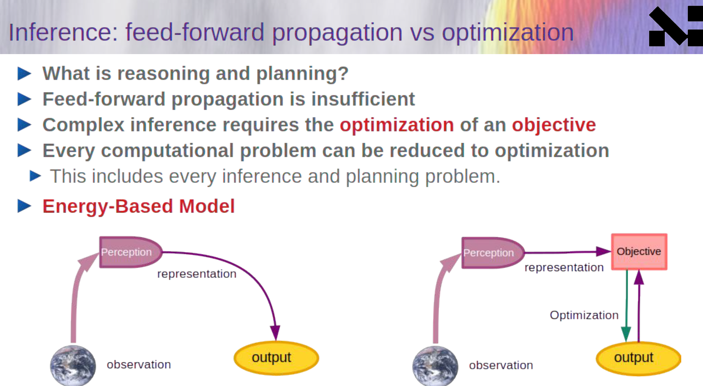

วันก่อนเห็นหลายคนโพสเรื่องของ LeCun ที่พูดที่ ECCV 2026 ที่สรุป 4 หัวข้อตาม cover image จากนั้นก็เห็นคนโพสเรื่อง Energy-Based Model แต่ดูจะไม่ตรงกับของ LeCun วันนี้เลยมาลองอ่านเพิ่มหน่อย

# Energy-Based Model (EBM)

โดยพื้นฐานเลย EBM คือ model ที่ให้ค่าต่ำเมื่อ input และ output มันเข้ากันได้ดี และให้ค่าสูงเมื่อไม่เข้ากัน เอาจริง ๆ มันก็ให้ความรู้สึกเหมือน loss function ผมเห็น EBM มานานแล้วเลยไม่อินสักที รู้แค่ว่าการเลือก non-probabilistic framework ทำให้ทำงานง่ายขึ้นเพราะไม่ต้องมา normalize  

เท่าที่คุยกับคุณ ChatGPT ดูเหมือนว่าการเปลี่ยนมุมมองจาก prediction function เป็นการวัด compatibility จะทำให้ทำงานได้ยืดหยุ่นขึ้น เช่น ในงาน Concept Learning with Energy-Based Models ของ Modatch จาก OpenAI ที่เห็นคนแชร์มา คือเขาสนใจฟังก์ชัน E_\theta(x,a,w) โดยที่ x เป็น input,  a เป็น attention mask และ  w เป็น latent code สำหรับ concept การใช้ฟังก์ชันเดียวเราสามารถทำได้หลายงาน ตัวอย่างใน paper คือ concept ของ “สี่เหลี่ยม”

- Recognition: optimize attention a^* = \arg \min_a E_\theta (x,a,w)  นั่นคือหา subset ของ input ผ่านการปรับ attention mask  หาจุดที่เรียงกันเป็นสี่เหลี่ยม

- Generation: optimize input x^* = \arg \min_x E_\theta (x,a,w) นั่นคือปรับตำแหน่งของจุดเพื่อให้ออกมาเป็นสี่เหลี่ยม 

- Concept Acquisition: given (x_i,a_i), i=1,.. optimize w^* =\arg \min_w \sum_i E_\theta (x_i,a_i,w)

ถึง EBM framework มันจะยืดหยุ่นดี แต่ผมก็ยังไม่ซื้อว่ามันดีนะ 555 เลยไปอ่านต่อ เจอว่าจริง ๆ แล้วของที่คุณ LeCun สนใจน่าจะเป็นในรูปล่างนี้ ที่เป็น optimization-based inference มากกว่า  คือระบบแบบนี้มันสามารถใช้ได้กับงานพวก search, planning ได้ด้วย นั่นคือเราไม่ควรสนใจเฉพาะ model ที่บังคับให้ตอบใน shot เดียว แต่ยังไม่เก็ตว่าทำไมแกเรียก EBM 555

จริง ๆ ใน slides ยังมีพวก hierarchical prediction ด้วย ซึ่งดูเข้ากับ optimization-based inference แต่ก็ยังดูไม่เข้ากับ EBM

# Joint-Embedding Model

อันนี้น่าจะเป็นงานหลักของ LeCun ช่วงหลังนี้แล้ว basic idea คือถ้าให้เรามองต้นไม้เราคงจำไม่ได้ว่ามีใบไม้กี่ใบอยู่ตรงไหนบ้าง ดังนั้นแกเลยว่า loss function ที่วัดจาก observation โดยตรงมันไม่ make sense และเสนอให้วัดจาก representation แทน ซึ่งอันนี้แหละที่น่าจะเหมาะกับ EBM  

งานกลุ่มนี้เห็นมาพักนึงแล้ว เดี๋ยวต้องไปหาต่อว่า joint-embedding นี่ใช้กับงาน generative ได้ด้วยมั๊ย

# Contrastive VS Regularization

อันนี้ดูจาก slides ไม่ค่อยเคลียร์ น่าจะเป็นเพราะว่าปัญหาหนึ่งของ EBM คือการที่ model ตอบ 0 เสมอ การทำ contrastive method ใช้คู่ตัวอย่างที่สุ่มเพื่อเพิ่มหรือลดค่า energy จะได้เลี่ยง trivial solution นี้ ซึ่งการสุ่มคู่ตัวอย่างที่ “ไม่เข้ากัน” มันอาจเกิดได้จากหลายสาเหตุ  และการสุ่มให้ครอบคลุมทุก condition ดูจะทำได้ยากโดยเฉพาะใน dimension สูง ๆ ส่วน regularization เป็นการบังคุบให้คนที่สร้างระบบเลือก regularization term ซึ่งถ้าเราจะแค่เลี่ยง trivial solution มันก็ทำได้ไม่ยาก และเราสามารถเพิ่ม term ตาม prior knowledge ของเราได้ด้วย เช่น representation ภายในคลาสควรจะคล้ายกัน (invariance) เป็นต้น

# RL VS model-predictive control

อันนี้ดูจาก slides แล้วไม่เข้าใจ คุณ ChatGPT เสนอว่า LeCun น่าจะอยากแยกระหว่าง learning how the world works จาก learning what to do หรือก็คือให้มา focus ที่การสร้าง world model แทนการทำ RL แบบที่ใช้ใน LLM มั๊ง

เท่าที่รู้ปัจจุบัน RL ใน LLM ใช้กัน 2 จุดคือ 

- ในการ train ต่อจาก next token prediction เพราะถ้าเราทำเฉพาะ next token prediction ตัว model จะเห็นเฉพาะ context ที่ถูกต้องเสมอ แต่ในการใช้งานเราเอา predicted token ไปใช้ต่อ ดังนั้น context ที่ใช้ predict ถัด ๆ ไปมันอาจจะเพี้ยน ๆ ได้

- พอ model gen text ได้รู้เรื่องแล้ว ก็ใช้ RL ในการเลือกว่าคำตอบไหนที่เราควรเลือก เช่นเลือกเพราะตรงกับที่ user อยากได้ หรือ RL from Human Feedback (RLHF) หรือใช้ AI ตัวอื่นให้ feedback ก็เป็น RL from AI Feedback (RLAIF) เพื่อตัดคอขวด human ออกไป หรือใช้ในการ train reasoning model

โดยงานเหล่านี้ focus ที่ reward model และการ train policy นั่นคือ learn what to do เฉย ๆ 

ส่วนงาน World Model ของ LeCun น่าจะประมาณว่า

- Policy / actor: “What action should I try?”→ suggest actions from the current perceived state.

- World model: “What would happen if I tried it?” → predicts consequences อันนี้กับการทำงานบน presentation น่าจะเป็นจุดที่ World model ของ LeCun ต่างจากของ Feifei Li

- Objective / critic: “How good would that outcome be?” → evaluates consequences

- Optimizer: “Which action or action sequence should I choose?” → chooses actions

อันนี้เป็นการแบ่งงานเฉย ๆ นั่นคือทั้งหมดนี้อาจเกิดใน NN ก้อนเดียวก็ได้

ยังมีงานเกี่ยวกับ World Model อีกหลายงาน ดู ๆ แล้วนิยามยังไม่ค่อยตรงกันเลย 555 ตัวอย่างเช่นงานของคู่กัดคุณ LeCun คือ Schmidhuber (Ha กับ Schmidhuber, NIPS 2018) ที่ใช้ VAE ในการ encode vision, ใช้ LSTM ในการทำนายว่า observation จะเปลี่ยนไปแบบไหน (ทำงานบน observation เหมือน LeCun) และมี Controller ในการเลือก action ของที่น่าสนใจคือเราสามารถ train Controller บน “ฝัน” หรือ sequence ที่ gen จาก LSTM ได้ด้วย และ Controller ที่ได้ทำงานจริงได้ดี 

ดู ๆ แล้ว LSTM ในงานนี้ก็คงเป็น World Model แบบหนึ่งนั่นเอง ถึง World Model ในงานนี้จะ pretrain และ freeze แต่ก็น่าจะปรับเป็น adaptive แบบของ LeCun ได้แหละ สิ่งที่ต่างจากงานของ LeCun จริง ๆ อาจจะอยู่ที่ Controller ซึ่งใน paper นี้มัน fix กับงานที่เขาทำ แต่ของ LeCun หลาย ๆ งานดูจะสนใจการ reuse World Model บนงานใหม่ด้วย นั่นคือทำการแยก task-agnostic dynamic learning ของ World Model และการ train Policy ของงานต่าง ๆ   ออกจากกัน

